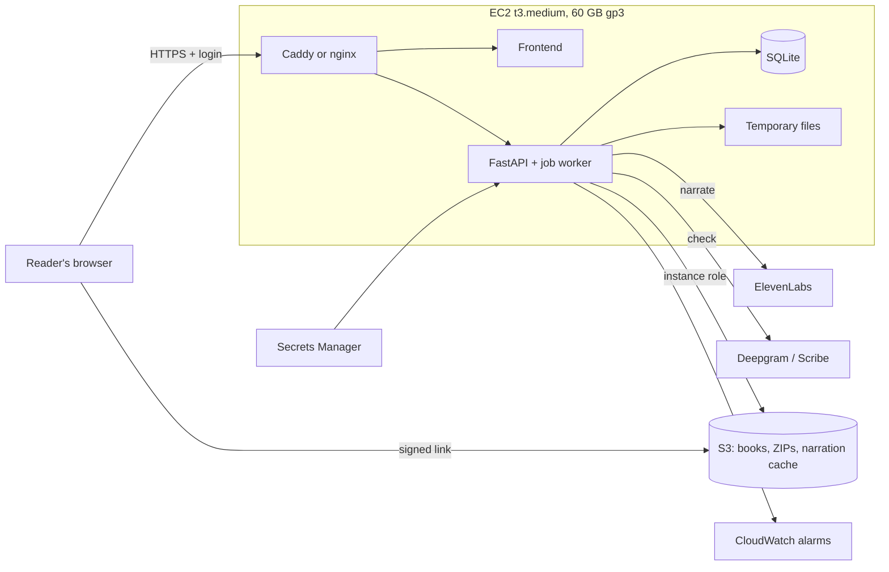
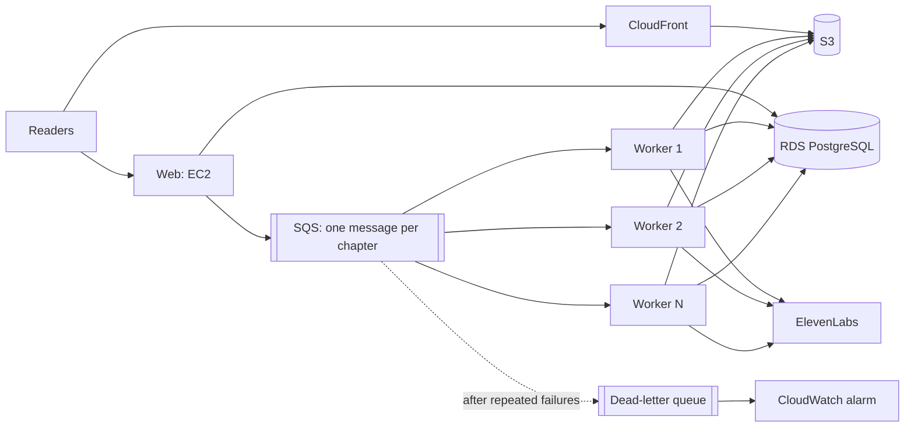

# Soni2 — cloud architecture, storage and cost

Target: **10 books a week of about 2 hours each** (20 hours a week, about 87 a
month, 1,040 a year), able to grow to 50 and 100 books a week without a rewrite.

Prices were read on 5 November 2026 for `eu-north-1` (Stockholm), where the server
runs, from AWS's public Price List API. They are on-demand, without savings plans
or the free tier unless a line says so. Sizes and rates marked *measured* come from
this project's production database. [Sources](#sources) are at the end.

## The short version

* **Narration is the bill; AWS is not.** At 10 books a week, AWS costs about $50 a
  month and ElevenLabs $351–$724. Each 2-hour book costs $8–$17 to narrate.
* **Do these first, whatever else you decide:** enlarge the disk (about $3 a month),
  raise the ElevenLabs quota, and put authentication in front of the site. Today
  anyone who finds the URL can spend your credits.
* **Stay simple at 10 books a week:** one larger EC2 instance, S3 for files, and
  SQLite. No SQS, RDS, ECS or CloudFront yet.
* **Add SQS, PostgreSQL and separate workers together**, when one worker can no
  longer keep up. They solve the same problem. ECS can wait until there are several
  workers to manage.

## What the measurements say

| Measured on production data | Value | Used for |
|---|---|---|
| Speech rate | 13.0 characters/s, 46,881 per hour (21,775 s of audio) | Credits per book |
| *Cuentos de la Selva* | 101,300 characters, 666 units, 2.15 h | Checks the rate above |
| Retakes | 6.5–8.8% more requests | 8% added to narration and transcription |
| Narration speed | 31.3 characters/s per concurrent request | Narration time |
| Mastering on the t3.micro | 356 s of audio in 44 s, about 8× real time | CPU: about 15 CPU-minutes per 2-hour book |
| Clip from ElevenLabs | 128 kbit/s mono | Cache size |
| Final MP3 | about 128 kbit/s (VBR) | File size |
| Database | 18.3 MB for 4,890 units, about 3.7 KB each | About 2.5 MB per book |
| Reports and logs | 5.2 MB for a 666-unit job | About 6 MB per book |

Mastering was measured once, on a short book and on CPU burst credits, so treat it
as an estimate. Run a real 2-hour book before relying on it.

## Storage

### Final MP3 files: one copy of each book

| Bitrate | One 2-hour book | 10 books a week | Per month | Per year | After 1 year | After 2 years | After 3 years |
|---|---:|---:|---:|---:|---:|---:|---:|
| 64 kbit/s | 57.6 MB | 0.58 GB | 2.5 GB | 30 GB | 30 GB | 60 GB | 90 GB |
| 96 kbit/s | 86.4 MB | 0.86 GB | 3.7 GB | 45 GB | 45 GB | 90 GB | 135 GB |
| 128 kbit/s | 115.2 MB | 1.15 GB | 5.0 GB | 60 GB | 60 GB | 120 GB | 180 GB |

Current output is about 128 kbit/s. You are happy with the quality, so this report
does not assume a change. For narrated speech, 96 kbit/s would save a quarter of the
final files, but it should be checked by ear and against ONCE's requirements first.

### Everything that is stored

At 128 kbit/s and 10 books a week:

| What | Per book | After 1 year | After 2 years | After 3 years | Assumption |
|---|---:|---:|---:|---:|---|
| 1. Final MP3s in the delivery ZIP | 231 MB | 120 GB | 241 GB | 361 GB | Chapter files plus the full-book file: two copies of the audio |
| 2. Uploaded source documents | 5 MB | 2.6 GB | 5.2 GB | 7.8 GB | Assumed average; *Cuentos* is 0.3 MB, a scanned PDF can reach 200 MB |
| 3. Temporary WAV | not kept | 0 | 0 | 0 | See below |
| 4. Intermediate files: narration cache | 124 MB | 65 GB | 129 GB | 194 GB | 128 kbit/s plus 8% retakes. **Keep it: it is what stops you paying twice** |
| 4. Intermediate files: reports, logs | 6 MB | 3.1 GB | 6.2 GB | 9.4 GB | Measured |
| 5. Database | 2.5 MB | 1.3 GB | 2.6 GB | 3.9 GB | Measured |
| **Total** | **369 MB** | **192 GB** | **384 GB** | **576 GB** | |
| 6. Backups | | 15–30 GB | 15–30 GB | 15–30 GB | Database dumps and EBS snapshots; S3 itself keeps the files |

**Temporary space is what fills the disk.** Audio is decoded to PCM (176 KB/s) one
passage at a time, so WAV-sized data is never held for a whole book; a whole book as
WAV would be 1.27 GB. Assembling a book does need room for its chapters, the full-book
file and the staged package at once, about 350–500 MB per book at the same time. It
also holds the audio in memory during assembly, an estimated 500 MB for a 2-hour book
(worked out from the code, not measured). That is why a 1 GB instance is too small.

**Disk use per job has dropped.** Before this upgrade a 2-hour book used about 690 MB:
every take and segment was a separate copy (`e839c189` measured 138 MB of takes and
115 MB of segments). Those are now hard links to the cache, for about 460 MB.

## Which AWS services, and when

| Service | Verdict | Why |
|---|---|---|
| **EC2** | **Yes, now** | Runs everything today. Move Soni2 off the t3.micro to its own t3.medium |
| **S3** | **Yes, from about month 3** | $2–$4 a month for what would cost $16 on EBS at month 12. Past about 50 GB the disk stops being the right home |
| **IAM** | **Yes, now** | Free. An instance role reaches S3 with no access keys on the server |
| **CloudWatch** | **Yes, a little** | Alarms for failed jobs, disk and credit errors: about $2 a month |
| **Secrets Manager** | **Yes, cheap** | $0.40 per secret. Keys stop living in a plain `.env` |
| **SQS** | **Later, with workers** | One process needs no queue. Costs almost nothing when needed |
| **RDS PostgreSQL** | **Later, with workers** | See below |
| **ECS** | **Not yet** | Worth it from about 4 or more workers, or when deployments start to hurt |
| **CloudFront** | **Optional** | S3 links are enough for a few downloads. Becomes useful for public listening: 1 TB a month free, against $0.09/GB direct |
| **Lambda** | **No** | Cannot hold ffmpeg work on whole chapters comfortably, and a narration run outlasts its 15-minute limit. It could run small tasks, but none is needed |

### SQLite or PostgreSQL?

**SQLite is enough while one process writes**, which includes the 10-book stage. It
has run all of production so far, its size is not a problem (about 1.3 GB a year),
and it costs nothing.

It stops being enough at the first separate worker. SQLite allows one writer at a
time, and its WAL mode requires every process to be on the same machine, so it cannot
be shared over a network. Moving is a contained job: `app/jobs.py` holds the SQL, but
it needs rewriting for PostgreSQL and the data migrating.

## Architecture

### Stage 1: 10 books a week

### Stage 2 and 3: 50–100 books a week

### What stays and what moves

| Stays on EC2 | Moves to S3 | Moves to RDS, at Stage 2 |
|---|---|---|
| Web app, nginx, the worker at Stage 1 | Uploads, delivery ZIPs, narration cache, chapter cache, reports | Jobs, units, attempts, events, drafts, lexicon, users |
| Temporary files during assembly (on local EBS) | Keep recent files on local disk as a read-through cache | |

**S3 lifecycle:** delivery ZIPs to Standard-IA after 30 days ($0.0125/GB), narration
cache to Glacier Instant Retrieval after 90 days ($0.004/GB). Re-editing an old book
then costs a small retrieval fee ($0.03/GB), far below narrating it again.

## Scaling: what gives out first

Bottlenecks, in the order they will appear:

| # | Bottleneck | 10/week | 50/week | 100/week | What to do |
|---|---|---|---:|---:|---|
| 1 | **ElevenLabs cost and quota** | 4.4 M chars/month | 21.9 M | 43.9 M | Plan, spend alerts, and a negotiated rate at volume |
| 2 | **Temporary disk** | About 0.5 GB a book | Several at once | Many at once | Per-worker disk; assemble one book at a time per worker |
| 3 | **Memory during assembly** | 4 GB is enough | Same, per worker | Same, per worker | Stream audio to disk instead of holding it in memory; this also shrinks every other stage |
| 4 | **Concurrent writes to SQLite** | Fine | Move at first separate worker | | PostgreSQL |
| 5 | **Credits for retakes** | About 8% | Same | Same | Keep verdict reuse; review the retake limit |
| 6 | **CPU for mastering** | 11 CPU-hours/month | 54 | 108 | Plenty of room on t3.medium workers, if not all at once |
| 7 | **ElevenLabs concurrency** | 9.7 h/month at 4 requests | 22 h at 9 | 28 h at 14 | Not limiting: the plan needed for the credits includes it |
| 8 | **Network** | Negligible | Negligible | Under the free TB | CloudFront when downloads grow |

Concurrency on ElevenLabs is 5 requests on Creator, 10 on Pro and 15 on Scale and
Business for Multilingual v2. The docs do not state a figure for v4; the server reads
the real limit from each reply. The figures above keep one request free.

### Not regenerating a book when a worker fails

Most of this exists now. What separate workers still need is marked.

| Failure | How it is handled |
|---|---|
| Worker dies mid-book | Every narrated paragraph is already in the content-addressed cache, so the rest of the book resumes from there. **Needs:** SQS redelivery after the visibility timeout |
| Same paragraph picked up twice | **Needs:** today's lock lives in one process (`AudioCache._locks`), so it does not protect two workers. Use a PostgreSQL advisory lock on the cache key before calling ElevenLabs. **This is the one change that protects money directly** |
| Job retried | Safe: the cache and the verdicts make a repeat free |
| Repeated failure | **Needs:** after 3–5 deliveries, a dead-letter queue and an alarm, so a bad message cannot retry for ever |
| Credit runs out | The job now stops cleanly and can be resumed; before this upgrade it crashed |
| Cache lost | `tools/reseed_cache.py` rebuilds it from the job folders. **Needs:** S3 versioning so this cannot happen by accident |

### What must change in the code for workers

The design holds, but these are real changes, in this order:

1. **File storage behind one interface.** `storage_root` and direct file paths are used
   throughout `main.py`, so S3 needs a small storage layer.
2. **`app/jobs.py` on PostgreSQL**, with its data migrated.
3. **`_start_or_resume_job` onto SQS.** Jobs run as tasks inside the web process today.
4. **Package tasks out of memory.** The direct download's progress lives in one process.
5. **The distributed lock** described above.

## Monthly cost

### AWS

Month 12 at each workload, on-demand in `eu-north-1`:

| Item | 10 books/week | 50 books/week | 100 books/week |
|---|---:|---:|---:|
| EC2 | $31.54 (t3.medium) | $78.84 (t3.small + 2 t3.medium) | $157.68 (t3.medium + 4 t3.medium) |
| EBS, including temporary storage | $5.02 (60 GB) | $9.20 (110 GB) | $16.72 (200 GB) |
| Public IPv4 | $3.65 | $10.95 | $18.25 |
| S3 storage, with lifecycle | $2.31 (191 GB) | $11.54 (954 GB) | $23.07 (1.9 TB) |
| S3 requests | $0.51 | $2.54 | $5.07 |
| Data transfer | $2.71 (direct) | $0 (through CloudFront) | $0 (through CloudFront) |
| CloudFront | Not used | $0 (under the free 1 TB) | $0 (under the free 1 TB) |
| Database | $0 (SQLite) | $30.09 (db.t4g.small, 50 GB) | $118.90 (db.t4g.medium Multi-AZ, 100 GB) |
| SQS | Not used | $0.16 | $0.32 |
| CloudWatch | $2.37 | $8.14 | $16.18 |
| Backups (snapshots) | $0.71 | $1.43 | $2.85 |
| Secrets Manager | $1.60 | $1.60 | $1.60 |
| **Total** | **about $50** | **about $154** | **about $361** |

Assumptions: 730 hours a month; 4.33 weeks a month; each book downloaded 3 times;
about 2,100 S3 uploads and 3,000 reads per book. S3 grows after month 12, by about
$1.90 a year at 10 books a week. Without the lifecycle rule S3 would be about twice
as much. The ALB a second web server would need is not included.

### Narration and transcription, not AWS

| Item | 10 books/week | 50 books/week | 100 books/week |
|---|---:|---:|---:|
| Audio per month | 87 h | 433 h | 867 h |
| Characters per month, with retakes | 4.39 M | 21.9 M | 43.9 M |
| **ElevenLabs, low** ($0.08 per 1,000) | **$351** | **$1,755** | **$3,510** |
| **ElevenLabs, high** ($0.165 per 1,000) | **$724** | **$3,620** | **$7,240** |
| Deepgram Nova-3 ($0.0043/min) | $24 | $121 | $241 |
| Scribe second check ($0.22/h, on about 10% of audio) | $2 | $10 | $19 |

**Why a range:** ElevenLabs' own pages disagree, and this must be settled from your
account before budgeting. Its [API pricing page](https://elevenlabs.io/pricing/api)
gives $0.08 per 1,000 characters for v4 and 1,238,000 characters on Pro. Its
[main pricing page](https://elevenlabs.io/pricing) gives 600,000 credits on Pro at 1
credit per character, which works out at $0.165 per 1,000. This project's billing
records show 1 credit per character.

Plans come in steps, so real bills differ a little. At 4.39 M characters: Scale ($299)
plus top-ups at the low rate, or Business ($990) at the high one. Top-ups replaced
overage billing for new self-serve customers, and they are capped each month without
two-factor authentication ($600 on Scale, $2,000 on Business). Above about 20 M a
month, ask for an Enterprise rate.

Producing an edited book again costs almost nothing here, so these figures are per
*new* book; only new or changed phrases are paid for.

## Answers to your questions

| Question | Recommendation |
|---|---|
| What stays on EC2? | The app and, at first, the worker |
| What moves to S3? | Every long-lived file, from about month 3 |
| Introduce SQS? | Only with separate workers |
| Separate workers? | When books wait in line for more than about a day, or at about 30 books a week |
| PostgreSQL? | At the first separate worker. Not before |
| When is ECS worthwhile? | At 4 or more workers, or when deployments become risky. Plain EC2 is simpler until then |
| Is CloudFront necessary? | Not at first. Add it for public listening, or when S3 egress exceeds a few dollars |
| Backups? | Daily EBS snapshots with Data Lifecycle Manager, kept 14 days. Daily SQLite backup to S3 (use the backup API, not a file copy, as this upgrade did). S3 versioning on the cache bucket. **Test a restore** |
| Authentication? | **Now:** restrict the security group to known addresses, or nginx basic auth. **Stage 1:** HTTPS plus accounts, with Amazon Cognito or a users table. **User libraries** then need a `user_id` on books, drafts and jobs |
| ElevenLabs keys? | Secrets Manager, read at start-up through an instance role. Use a key per environment, with the narrowest permissions and a spending limit on the key |
| Failed jobs? | A CloudWatch alarm on `job.fail` in the logs and on credit errors, plus disk over 80% |

## Migration plan

### Stage 0: this week, about $3 a month

1. **Restrict access.** The API has no authentication and the site is plain HTTP on a
   public port. Limit port 5173 to your addresses.
2. **Grow the EBS volume** from 8 GB to 40 GB: $2.68 a month, online, with no restart
   beyond extending the file system. 168 MB is free today, and a 2-hour book needs
   about 500 MB to assemble: *Cuentos* cannot be finished until this is done.
3. **Raise the ElevenLabs quota.** The API key is at its 100,000 limit with 0 credits.
   The plan cannot cover the target workload either way.
4. **Finish *Cuentos*.** 664 of 666 paragraphs are back in the cache, so this costs
   about 461 credits.
5. **Back up:** a snapshot schedule and a daily database copy.

### Stage 1: about 10 books a week, about $50 a month

1. A t3.medium for Soni2 alone, so it and `prospecting` can no longer fill each other's disk.
2. HTTPS and accounts.
3. Keys in Secrets Manager, an instance role, and CloudWatch alarms.
4. The storage layer and S3, with lifecycle rules, keeping SQLite.
5. Stream audio to disk during assembly, so memory no longer grows with the book.

### Stage 2: from about 30 books a week, about $154 a month at 50

PostgreSQL, SQS with a dead-letter queue, the distributed lock, and 2 workers.
CloudFront if the audiobooks are served to listeners.

### Stage 3: 100 books a week and beyond, about $361 a month

More workers, Multi-AZ, ECS if the fleet warrants it, and an ElevenLabs contract.

Each stage works without the next, and none requires rewriting the pipeline.

## What would make this more accurate

* Your ElevenLabs plan and negotiated rate. That is the biggest uncertainty here.
* How long a real 2-hour book takes to master on the target instance.
* How many times each book is downloaded or streamed.
* Your real average source size, particularly scanned PDFs.
* Whether ONCE requires a particular bitrate.
* Whether the 100 GB of free AWS egress or a savings plan applies to your account;
  neither is counted here. A one-year plan typically lowers EC2 costs noticeably.

## Sources

Read on 5 November 2026.

* [AWS Price List API](https://docs.aws.amazon.com/awsaccountbilling/latest/aboutv2/using-the-aws-price-list-bulk-api.html),
  region `eu-north-1`:
  [S3](https://pricing.us-east-1.amazonaws.com/offers/v1.0/aws/AmazonS3/current/eu-north-1/index.json),
  [EC2 and EBS](https://pricing.us-east-1.amazonaws.com/offers/v1.0/aws/AmazonEC2/current/eu-north-1/index.json),
  [RDS](https://pricing.us-east-1.amazonaws.com/offers/v1.0/aws/AmazonRDS/current/eu-north-1/index.json),
  [SQS](https://pricing.us-east-1.amazonaws.com/offers/v1.0/aws/AWSQueueService/current/eu-north-1/index.json),
  [CloudWatch](https://pricing.us-east-1.amazonaws.com/offers/v1.0/aws/AmazonCloudWatch/current/eu-north-1/index.json),
  [Secrets Manager](https://pricing.us-east-1.amazonaws.com/offers/v1.0/aws/AWSSecretsManager/current/eu-north-1/index.json),
  [data transfer](https://pricing.us-east-1.amazonaws.com/offers/v1.0/aws/AWSDataTransfer/current/eu-north-1/index.json),
  [public IPv4](https://pricing.us-east-1.amazonaws.com/offers/v1.0/aws/AmazonVPC/current/eu-north-1/index.json)
* [Amazon CloudFront pricing](https://aws.amazon.com/cloudfront/pricing/) and
  [pay-as-you-go](https://aws.amazon.com/cloudfront/pricing/pay-as-you-go/)
* ElevenLabs: [pricing](https://elevenlabs.io/pricing),
  [API pricing](https://elevenlabs.io/pricing/api),
  [pay as you go](https://elevenlabs.io/docs/overview/administration/pay-as-you-go),
  [models and concurrency](https://elevenlabs.io/docs/overview/models)
* [Deepgram pricing](https://deepgram.com/pricing)
* SQLite: [write-ahead logging](https://www.sqlite.org/wal.html)
